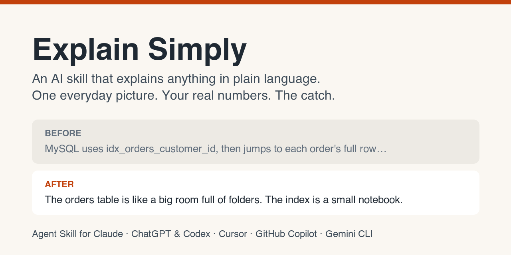

# Explain Simply: an AI skill that explains anything in plain language

[العربية](README.ar.md)

**Explain Simply** is a free [Agent Skill](https://agentskills.io) that makes AI assistants
explain complicated things in plain, everyday language. Instead of jargon, you get one picture
from daily life, short sentences, your own real numbers, and an honest "catch". It's like
"explain it like I'm 5" (ELI5), but written for adults.

It's made for **anyone**, not only developers: a manager reading a developer's message, someone
comparing two bank loans, a student, or a developer trying to understand a database. It works in
**Claude** (the app, claude.ai and Claude Code), and in other tools that support Agent Skills,
such as **ChatGPT & Codex, Cursor, GitHub Copilot and Gemini CLI**.



---

## Quick install

- **Claude app or claude.ai:** download
  [explain-simply.zip](https://github.com/AbdulrahmanMasoud/explain-simply/releases/latest/download/explain-simply.zip),
  then go to **Customize > Skills > + > Create skill > Upload a skill**.
  [Step-by-step guide](#install-in-the-claude-app-or-on-claudeai)
- **Claude Code:**

  ```bash
  git clone https://github.com/AbdulrahmanMasoud/explain-simply.git
  mkdir -p ~/.claude/skills && cp -r explain-simply/explain-simply ~/.claude/skills/
  ```

- **ChatGPT & Codex, Cursor, GitHub Copilot, Gemini CLI and others:**
  [see below](#install-in-other-ai-tools).

---

## Before and after

Someone asked why their database needed an "index". The first answer was correct, but full of
technical words:

> MySQL uses `idx_orders_customer_id` to find the orders. Then, for each order, it jumps to that
> order's full row in the table to read the other five values. The table is about 2 GB, and the
> server only keeps part of it in memory…

They replied: *"I still don't understand it, make it easy."* This was the answer that worked:

> **The orders table is like a big room full of folders.** Each order is one big folder. To answer
> our question we only need 6 small facts from each folder.
>
> **Without the index**, the database walks to every folder and opens it. 2 million folders,
> every time. That's why it took **8 to 90 seconds**.
>
> **With the index**, it reads a **small notebook** that already has those 6 facts. **Less than
> 1 second.**

Explain Simply teaches the AI to answer like the second one, from the start.
[See the full example](examples/1-database-index.md), and [more examples below](#examples).

---

## How does it explain things?

Every explanation has the same 7 parts:

1. **One picture from daily life.** "The table is a room full of folders." It keeps the same
   picture until the end.
2. **What actually matters.** The small core of the problem, in a line or two.
3. **Without it.** What happens now, with real numbers.
4. **With it.** What changes, with real numbers and a tiny example.
5. **Why it matters to you.** Your money, your customers, your time.
6. **The catch.** What it costs or risks. No sales pitch.
7. **The answer in one line.** "So yes, do it."

It also follows a few rules:
- **Short sentences and everyday words.**
- **Your numbers.** It uses the ones you give it and never invents numbers.
- **If you still don't understand,** it tries a different picture instead of adding more detail.
- **Health, law and money:** it explains the idea but doesn't make the decision for you.

---

## Explain Simply vs. asking for "ELI5"

| | Asking "explain like I'm 5" | Explain Simply |
|---|---|---|
| Who it's written for | A child | An adult who isn't an expert in this topic |
| Your numbers (prices, times, sizes) | Often dropped | Kept, and used in the explanation |
| Downsides | Usually missing | Always has a "catch" section |
| Shape of the answer | Different every time | The same 7 parts every time |
| If you still don't get it | Usually the same explanation, longer | A different picture, shorter |
| Length | Varies | Usually shorter. In our three tests, 4% to 26% shorter than without the skill |

---

## Install in the Claude app or on claude.ai

No coding needed.

1. Open **Settings > Capabilities** and turn on **Code execution and file creation**.
   Skills need it.
2. Download
   [explain-simply.zip](https://github.com/AbdulrahmanMasoud/explain-simply/releases/latest/download/explain-simply.zip).
   Don't unzip it.
3. In Claude, go to **Customize > Skills**, click **+**, then **+ Create skill**, then
   **Upload a skill**, and choose `explain-simply.zip`.
4. Check that the skill is switched on in your skills list.

Want to build the zip yourself? Zip **only** the inner `explain-simply` folder (the one with
`SKILL.md` inside).

## Install in Claude Code

To use it in all your projects:

```bash
git clone https://github.com/AbdulrahmanMasoud/explain-simply.git
mkdir -p ~/.claude/skills
cp -r explain-simply/explain-simply ~/.claude/skills/
```

On Windows, copy the inner `explain-simply` folder to `%USERPROFILE%\.claude\skills\`.

To share it with your team in one project, put the folder at `.claude/skills/explain-simply/`
inside that project and commit it. Start a new Claude Code session afterwards.

## Install in other AI tools

Explain Simply uses the open [Agent Skills](https://agentskills.io) format, so the same
`explain-simply` folder works in other tools that support it. Copy the folder to your tool's
skills folder, as its own guide explains:

| Tool | Guide |
|---|---|
| ChatGPT & Codex | [Codex skills](https://developers.openai.com/codex/skills/) |
| Cursor | [Cursor skills](https://cursor.com/docs/context/skills) |
| GitHub Copilot | [About agent skills](https://docs.github.com/en/copilot/concepts/agents/about-agent-skills) |
| VS Code | [Agent skills in VS Code](https://code.visualstudio.com/docs/copilot/customization/agent-skills) |
| Gemini CLI | [Gemini CLI skills](https://geminicli.com/docs/cli/skills/) |
| More tools | [All tools that support Agent Skills](https://agentskills.io/clients) |

---

## How do I use it?

Just talk normally. The AI uses the skill on its own when you say things like:

- "I don't understand, can you make it simple?"
- "Explain it like I'm not technical."
- "ELI5: what is a CDN?"
- "Why do we need this?"
- "What does *two-factor authentication* actually mean?"
- "My developer says X. What does that mean, and is it worth it?"

In Claude Code you can also call it directly:

```
/explain-simply why our developer wants a CDN
```

**Tip:** give your real numbers, like your loan amount, your page load time or your bill. The
explanation will use them, and it becomes much clearer.

---

## Examples

Each example shows the same question answered **before** (without the skill) and **after**
(with it).

| # | Who's asking | Question | The picture it used |
|---|---|---|---|
| 1 | A developer | [Why do we need a database index?](examples/1-database-index.md) | A room of folders and a small notebook |
| 2 | Anyone with a work email | [Why turn on two-factor login if my password is strong?](examples/2-two-factor-login.md) | A house key, and a guard who phones you |
| 3 | Someone taking a car loan | [Fixed or variable interest rate?](examples/3-car-loan-interest.md) | A fixed price vs. a taxi meter |
| 4 | A marketing manager | [The developer says "compress images and add a CDN". What?](examples/4-slow-website.md) | A heavy parcel, and local branch warehouses |

**How the examples were made:** example 1 is based on the real conversation this skill came
from, with the names and numbers changed to demo data.
Examples 2 to 4 asked Claude the same question twice, once without the skill and once with
it, and show both answers unedited.

To be fair, Claude already explains everyday questions well without the skill. What the skill
adds is a steady shape: one picture, your numbers, the catch, and a clear answer. The difference
is biggest when the first answer was too technical, like in example 1.

---

## Questions and answers

### What is an Agent Skill?

A skill is a folder with a `SKILL.md` file that teaches an AI assistant how to do one job well.
The AI reads it only when it's needed. Agent Skills is an open format, first made by Anthropic,
that many AI tools support. See [agentskills.io](https://agentskills.io).

### Is Explain Simply free?

Yes. Download it, use it and change it for yourself or your team.

### Is it only for developers?

No. It works for any topic that's hard to follow: technology, money, contracts, health,
science, or a decision at work. Three of the four examples aren't about code.

### Does it work in Arabic or other languages?

Yes. It answers in the language you write in. In Arabic, it explains in simple Egyptian Arabic
and keeps technical terms in English. You can change this in `SKILL.md`.

### Will it make the answers longer?

No. In our three tests, the answers with the skill were 4% to 26% shorter, because the skill
keeps explanations to about one screen.

### Will it talk to me like a child?

No. It's written for adults who aren't experts in the topic. It keeps the real numbers and the
details that matter for your decision, and leaves out the rest.

### Can it give financial, medical or legal advice?

It explains the idea clearly, but it doesn't make the personal decision for you or give a
diagnosis. It tells you who to ask, like a doctor, a lawyer or your bank.

### How do I add my own pictures and comparisons?

Open [`explain-simply/SKILL.md`](explain-simply/SKILL.md) in any text editor and add rows to the
**Choosing the picture** table, for example comparisons from your own industry. If you use the
Claude app, upload the zip again after editing. In Claude Code, the change works in your next
session.

---

## What's in this repository

```
explain-simply/
├── README.md               this page
├── README.ar.md            this page in Arabic
├── explain-simply/
│   └── SKILL.md            the skill itself (this is the folder you install)
├── examples/               before and after examples
└── assets/                 the preview image
```
